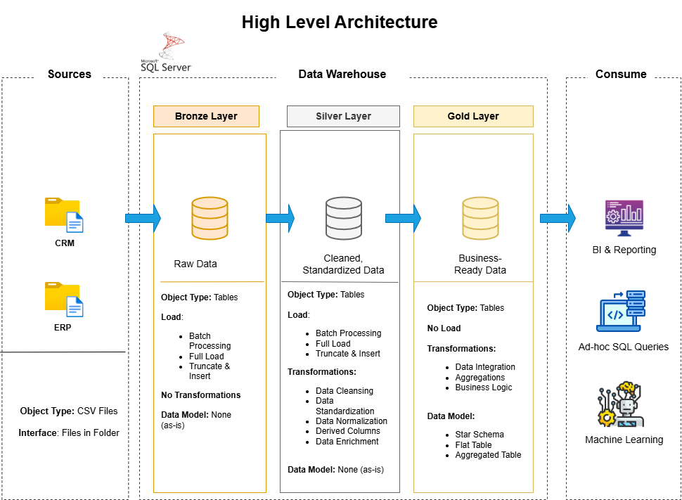

# Data Warehouse Project

Welcome to the Data Warehouse Project repository! 🚀

This project showcases the design and implementation of a modern data warehouse using Microsoft SQL Server and Medallion Architecture. It covers the complete data engineering workflow, including data ingestion, data cleansing, ETL processes, and dimensional data modeling.

The project simulates a real-world data warehouse environment, focusing on clean architecture, maintainability, and analytics-ready datasets. 

---

## 🏗️ Data Architecture
The data architecture for this project follows Medallion Architecture **Bronze**, **Silver**, and **Gold** layers:

1. **Bronze Layer:** Stores raw data ingested from CSV files into Microsoft SQL Server.
2. **Silver Layer:** Cleans, standardizes, and transforms data for analysis.
3. **Gold Layer:** Contains business-ready data modeled in a star schema consisting of fact and dimension views, designed to support analytical queries and reporting.

---

## 📖 Project Requirements

### Building the Data Warehouse

#### Objective
Build a modern data warehouse using Microsoft SQL Server to consolidate sales data and support reporting and data-driven decision-making.

#### Specifications
- **Data Sources:** Import data from two source systems (ERP and CRM) provided as CSV files.
- **Data Quality:** Clean and resolve data quality issues before analysis.
- **Data Integration:** Combine both sources into a single, analytics-friendly data model optimized for querying.
- **Data Modeling:** Design a Gold layer using a star schema with fact and dimension views.
- **Scope:** Focus on the latest dataset, historical data tracking is outside the scope of this project.
- **Documentation:** Document the architecture, data model, and Gold layer objects.

---

## 🛡️ License
This project is licensed under the MIT License. You are free to use, modify, and share this project with proper attribution.

## 📚 About Me
Hi there! I'm **Nidal Aamir**, an aspiring Data Engineer focused on building strong foundations in data engineering, data warehousing, and modern data architecture. I am expanding my skills in distributed data processing using Databricks and exploring cloud data engineering services within the Microsoft Azure ecosystem. 
